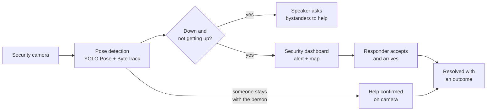

# HEADS-UP

**Getting help to people who can't ask for it.**

HEADS-UP turns an existing security camera into a safety net. When someone collapses or falls in a transit station and doesn't get up, it asks bystanders nearby to check on them, alerts security staff, and tracks the alert until help has actually reached the person.

Built at Hack the Valley for the **Project KAZE** challenge: *How might we help people stay safe and get assistance when they are no longer in a position to ask for help themselves?*

---

## The problem

A drink can be spiked. Someone can become severely intoxicated, faint, or lose consciousness. In that moment they can't call, text, or press an SOS button, and in a busy station it's easy for everyone to assume someone else has noticed.

The dangerous part is the **gap** between the moment a person can no longer help themselves and the moment someone realizes they need help. HEADS-UP is built to close that gap, and to prove it closed.

## How it works



1. **Detect.** A pose model tracks each person's body. If someone ends up lying down and stays down (3 seconds after a fast fall, 12 seconds after a slow collapse), an alert fires. Getting back up cancels it.
2. **Ask the people nearby.** A speaker near the camera says *"Attention please. Someone near Union Station may need help. If you are nearby, please check on them."* Bystanders are usually seconds away; staff may be minutes away.
3. **Alert security.** The response desk dashboard dings and shows the alert with *why* it fired, where it is on the TTC map, and a live camera view.
4. **Confirm help arrived.** The alert stays open until a responder taps **I'm here**, or the camera sees someone stay with the person for 10 seconds. Then the speaker says *"Help is here, there's no need to worry."*
5. **Escalate if nobody responds.** If no one accepts the alert within 60 seconds, a backup responder is notified.

## Features

- **Collapse detection that ignores everyday movement:** sitting, bending, kneeling, or someone walking past don't trigger it.
- **Explainable alerts:** every alert says why it fired, e.g. *"Went down slowly, like slumping or sliding down · Lying down for 12s · Very little movement in the last 5s."*
- **Bystander announcements** naming the location only. Several people down at one spot are announced together, and the speaker gives an update when each one gets help or gets back up.
- **Closed-loop response:** went down → alert → accepted → help reached them → resolved, with a timeline on every alert.
- **The key stat, measured live:** % of alerts where help actually reached the person, and median time from going down to help arriving.
- **TTC incident map** showing alerts at their station, plus read-only, expiring links to share an alert's location with a responder.
- **Reliability built in:** automatic backup escalation, a camera-offline warning, alert sounds, and handling for a person who gets up and goes down again.

## Safety, dignity, privacy and autonomy

- **Location, never identity.** Announcements and alerts never describe the person, and responder links share only location and status.
- **No guessing why.** It says "someone may need help," never "possibly drugged" or "intoxicated." Its job is to get help there, not to diagnose.
- **A welfare check, not enforcement.** The response is a person checking in, never a penalty, including for someone simply resting.
- **Humans stay in charge.** It never calls 911 by itself; escalating to emergency services is a responder's decision.
- **Video stays local.** Camera frames are processed on the device; only alert details are sent to the dashboard.

## Tech stack

| Part | Tech |
|---|---|
| Vision | Python, OpenCV, [Ultralytics YOLO Pose](https://docs.ultralytics.com/tasks/pose/), ByteTrack |
| Detection | Temporal rules and a state machine over body keypoints (`vision/detector.py`) |
| Backend | FastAPI, SQLite, WebSockets |
| Dashboard | React, Vite, Tailwind CSS, Leaflet |
| Speaker | macOS text-to-speech (`say`), through laptop speakers or a Bluetooth speaker |
| Map data | City of Toronto open data (TTC lines and stations), OpenStreetMap |

## Getting started

You need **Python 3.12** and **Node 20+**. The camera runs on a webcam; on a Mac with Apple Silicon it uses the GPU.

### 1. Install

```bash
git clone https://github.com/kaleyw/hackthevalley.git
cd hackthevalley
python3.12 -m venv .venv
.venv/bin/pip install -r requirements.txt
npm install --prefix dashboard
cp .env.example .env
```

Open `.env` and set `CAMERA_LOCATION` to the place the speaker should name, e.g. `Union Station`.

### 2. Run

Use three terminals, all from the project folder:

```bash
.venv/bin/uvicorn backend.app.main:app --reload
```

```bash
npm run dev --prefix dashboard
```

```bash
.venv/bin/python vision/run.py --debug
```

Open **http://localhost:5173** and click the banner once to turn on alert sounds. The first time, macOS asks to let your terminal use the camera.

- Press `q` in the video window (or `Ctrl + C`) to stop the camera.
- Add `--device cpu` if the GPU (`mps`) gives an error, or `--source path/to/video.mp4` to use a video instead of the webcam.
- Make sure your computer isn't muted, or you won't hear the announcements.

### 3. Optional: responder links

To share an alert's location with a responder, set `MAP_OPERATOR_KEY` in `.env` and run the read-only responder page next to the others. See [docs/MAP.md](docs/MAP.md).

## Try it

1. Stand in front of the camera with your whole body in view, then **slowly lie down on a mat** and stay still.
2. The video shows a countdown (`DOWN 3s/12s`). At 12 seconds the dashboard dings and the speaker asks bystanders for help.
3. Click **Accept, I'm going** on the dashboard.
4. Have a teammate kneel beside you for 10 seconds (*"Someone is with the person now."*), or click **I'm here** (*"Help is here…"*).
5. Click **Resolve** and choose what happened. The stats update.

Please don't perform real falls when testing. Slow lie-downs are safe and trigger the same alert.

## Configuration

Settings live in `.env` (see `.env.example`); detection thresholds are in `vision/config.py`.

| Setting | What it does | Default |
|---|---|---|
| `CAMERA_LOCATION` | Location the speaker and dashboard name | `Union Station` |
| `CAMERA_STATION` | TTC station cameras are shown at on the map | `Union` |
| `SPEAKER_ENABLED` | Spoken announcements on (`1`) or off (`0`) | `1` |
| `SPEAKER_REPEAT_SECONDS` | How often the announcement repeats until help arrives | `20` |
| `ACK_TIMEOUT_SECONDS` | Seconds before an unaccepted alert notifies a backup responder | `60` |
| `STREAM_PORT` | Local port for the dashboard's live camera view (`0` = off) | `8090` |
| `MAP_OPERATOR_KEY` | Secret for responder links and changing camera locations | *(empty)* |

## Project structure

```
vision/      Camera: pose tracking, collapse detection, help confirmation, live stream
backend/     API, alert lifecycle, escalation, speaker, TTC map and responder links
dashboard/   The HEADS-UP response desk (React)
docs/        How it works in detail, map setup
data/        Test videos and run logs (not committed)
```

How detection, the alert lifecycle and the API work in detail: [docs/HOW_IT_WORKS.md](docs/HOW_IT_WORKS.md).

## Tests

```bash
.venv/bin/pip install -r requirements-test.txt
.venv/bin/python -m unittest backend.test_maps -v
node --test dashboard/src/mapLayout.test.js
```

## Limitations

- Detection thresholds are prototype values tuned on our own tests; they are **not medically validated**.
- It's built for one fixed camera with the person's whole body in view. Very high or overhead angles, crowds, and someone slumped while still seated are harder.
- The speaker uses macOS text-to-speech; on other systems announcements are only logged.
- It doesn't contact emergency services or send messages automatically.
- Places without cameras (dorm rooms, private spaces) aren't covered. The alert pipeline accepts alerts from any source, so phone or wearable triggers could plug into it in the future.

## Team

Built at Hack the Valley by [@kaleyw](https://github.com/kaleyw), [@jnoh24](https://github.com/jnoh24), [@Harini-UW](https://github.com/Harini-UW) and [@gakharnaysha](https://github.com/gakharnaysha).

## Credits

- Pose detection and tracking: [Ultralytics YOLO](https://github.com/ultralytics/ultralytics) (AGPL-3.0) with ByteTrack
- TTC lines and stations: City of Toronto, [Open Government Licence – Toronto](https://open.toronto.ca/open-data-licence/) (details in [dashboard/public/maps/SOURCES.md](dashboard/public/maps/SOURCES.md))
- Street map: © [OpenStreetMap](https://www.openstreetmap.org/copyright) contributors
