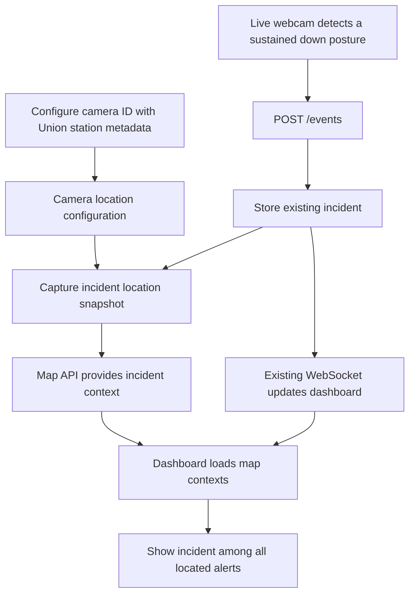

# TTC incident map: feature summary and walkthrough

This feature adds geographic context and restricted responder sharing to the
existing fall-alert workflow. A live camera can detect someone going down,
create an incident, and have that incident appear at the location configured
for that camera—for example, an approximate location at Union Station.

**The map does not determine where the webcam physically is.** Union is a
configured demonstration location. The prototype does not call 911, send SMS
or email, or transmit map links to emergency services.

For installation, service commands, and rehearsal instructions, see
[TTC_MAP_DEMO.md](TTC_MAP_DEMO.md).

## 1. What was added

| Feature | Behavior |
| --- | --- |
| Integrated incident map | Appears alongside the dashboard when incidents are loaded. |
| TTC geography | Uses Leaflet with locally stored station and route GeoJSON. |
| All-alert overview | Shows all currently loaded incidents with usable coordinates, including active and past alerts. |
| Shared-location labels | Lists incidents at the same location separately, with active incidents first. |
| Camera metadata | Associates a camera ID with a station/platform or train/car. |
| Detection snapshot | Preserves location information available when an incident was created. |
| Current location context | Holds supplemental information and staff-confirmed platform transfers separately. |
| Train simulator | Produces clearly labelled synthetic train positions with timestamps. |
| Restricted responder page | Shares one incident through an expiring, revocable, read-only link. |
| Text briefing | Provides a copyable incident/location summary independent of geographic rendering. |
| Failure handling | Retains last-known information and keeps map errors separate from existing alert actions. |

## 2. How a live alert reaches the map



For the live demonstration:

1. The webcam uses the camera ID `cam-1`.
2. Configuration assigns `cam-1` to Union Station.
3. The existing vision pipeline detects someone going down and staying down.
4. Vision posts its normal alert to the backend.
5. The backend stores the incident using the existing event workflow.
6. An additive map hook copies that camera's metadata into an incident-specific snapshot.
7. The dashboard receives the incident through its existing WebSocket connection.
8. The map panel fetches location context and displays the incident at Union.

The geographic assignment is a camera-ID lookup. It does not require a live
TTC camera, GPS, browser geolocation, or knowledge of the laptop's location.

### Three identifiers/settings that serve different purposes

| Value | Purpose |
| --- | --- |
| `camera_id`, such as `cam-1` | Connects a camera alert to that camera's stored map configuration. |
| `CAMERA_LOCATION` in `.env` | Supplies the human-readable location text on alerts and heartbeats. |
| Map location metadata | Supplies station/platform information and geographic coordinates for the map. |

Changing the map configuration does not automatically rewrite `CAMERA_LOCATION`.
After editing `CAMERA_LOCATION`, restart vision so new incidents use the new text.
Old incidents retain the text originally stored with them.

## 3. What camera configuration contains

Platform metadata can include:

- Station ID and name.
- Platform label, line, and direction.
- Latitude/longitude with explicit coordinate precision.
- A staff-verified meeting-point description, optionally with coordinates.
- Location source: configured, telemetry, estimated, or simulated.

Train metadata additionally supports a train ID and car ID. Train ID is required
for train camera configurations. Source labels describe the supplied data;
selecting `telemetry` does not itself connect a live feed.

If a recognized station is selected without explicit coordinates, the backend
looks up its point in the local TTC dataset. The interface labels that point
**approximate station location**. It does not invent a precise platform or entrance.
If no coordinates can be obtained, the alert still works and shows
**location unavailable**.

A meeting point requires `verified: true`. This records a staff assertion;
the application does not independently verify the description or coordinates.

## 4. Historical location versus current location

These records are intentionally separate:

| Record | Meaning | Can later updates replace it? |
| --- | --- | --- |
| Detection snapshot | Camera metadata and a sufficiently recent train sample available at detection time. | No. |
| Supplemental location | Information supplied after incident creation. | Yes, without changing the snapshot. |
| Confirmed transfer | A timestamped staff assertion that the person transferred to a platform. | A later transfer can replace the current transfer record. |
| Latest train position | The most recent accepted sample for the associated train. | Yes; out-of-order samples are rejected. |

A train sample is included in the detection snapshot only when it was observed
at or before the incident's detection timestamp and no more than 10 seconds earlier.

Legacy incidents or snapshot-capture failures do not get a fabricated historical
location. They retain an unavailable snapshot, and staff can supply supplemental
context later.

The frontend prefers confirmed-transfer metadata, then supplemental metadata,
then the original camera metadata. For a marker, it uses coordinates from that
current context when available, otherwise the detection coordinates, otherwise
the latest associated train coordinates. A latest train coordinate represents
the train, not a verified position of the person.

## 5. How all alerts are displayed together

The map shows all located incidents currently loaded in the dashboard. The
initial event fetch uses the existing latest-100 limit; subsequent WebSocket
messages add/update incidents in the current dashboard session. This is not an
unlimited archive browser.

- Different locations get separate marker groups.
- Incidents whose coordinates match when rounded to five decimal places share
  a visible label stack at the existing coordinates.
- Each incident keeps its own ID, status label, color, and selectable button.
- Active incidents appear before resolved/dismissed ones; within those groups,
  newer incident IDs appear first.
- Long stacks scroll instead of covering labels with another marker.
- Selecting an incident changes its details, not which incidents are displayed.
- The view fits the incident locations when the incident/location set changes.
  **Fit all alerts** restores that overview after manual panning or zooming.
- Incidents without usable coordinates are counted as location unavailable;
  they remain available through the dashboard and details selector.
- Associated trains appear once per train ID, using the newest available sample.

For example, an accepted live incident `#3` and a dismissed demo incident `#2`
at Union appear as two separate labels in the same Union group. The dismissed
marker cannot cover the live incident. The dropdown now selects **details**;
it does not filter the map to a single incident.

The selected incident's original detection coordinates are also drawn as a dashed
ring when available. Colors are supplemented by status text and symbols.

## 6. Updates, simulation, and connectivity

Existing incident creation/status changes still use WebSockets. The map panel
fetches incident context independently every two seconds. The responder page
also polls its restricted endpoint every two seconds.

The train provider currently simulates **DEMO-T1** travelling from Union through
King, Queen, and Dundas, then back. It uses straight segments between station
points, not surveyed track geometry or a timetable-derived live position.

| Simulator control | Result |
| --- | --- |
| Start / reconnect | Produces fresh samples and resumes movement from the stored simulated progress. |
| Pause movement | Continues producing fresh samples at a stationary position. |
| Disconnect telemetry | Stops producing samples and retains the last-known coordinates. |

Samples become stale after 10 seconds. The map shows observation time, sample
age, source, and stale/provider-connection indicators. Animation interpolates
only between known fresh samples; it does not extrapolate movement through an outage.

If map-context requests fail, the frontend retains its last received context
and indicates disconnection. If geographic files fail, the textual location
briefing remains usable. These fallbacks are not an offline incident-submission
queue and do not add new recovery behavior to the existing vision/backend system.

## 7. Escalation and map handoff

Both automatic and manual escalation use the existing backend escalation function.
The map hook runs **after the existing escalation is stored and broadcast**.
It prepares or reuses a separate map-handoff record.

Existing automatic conditions remain:

- Open incidents older than the acceptance timeout, default 30 seconds, escalate
  once to level 1.
- Acknowledged incidents older than the arrival timeout, default 90 seconds,
  escalate up to level 2 if neither arrival nor camera-confirmed presence is recorded.
- The existing watchdog checks every two seconds, so escalation appears on the
  next eligible pass rather than at an exact browser countdown instant.

The original Accept, Arrive, Resolve, Dismiss, and manual Escalate rules remain
unchanged. Map selection, copying, sharing, and transfer recording do not change
those statuses or restart incident timers.

If handoff preparation fails, the existing escalation still succeeds. Later
map reads can reconcile a missing handoff from the stored escalation level.
Repeated preparation reuses the record; it does not repeat escalation or silently
renew a revoked/expired link.

**There is no emergency-call or notification provider in this implementation.**
The existing “Backup responder notified” and “Supervisor notified” labels are
recorded dashboard/log states. Handoff delivery is `unsupported`; send-attempt,
delivery, and responder-acknowledgment timestamps remain unset. A generated link
or an opened responder page is not evidence of delivery or acknowledgment.

## 8. Restricted responder sharing

The dashboard offers:

- Prepare / reuse map link.
- Copy map link.
- Open demo responder view.
- Renew link.
- Revoke link.
- Copy location briefing.

The operator enters `MAP_OPERATOR_KEY` to manage configuration, links, transfers,
and simulator controls. The dashboard stores that key in browser session storage.
It is not an individual responder login or role-management system.

Links use a random 256-bit nonce and an HMAC signature bound to the incident and
server-stored expiry. Default validity is one hour. Tokens are checked on the
server; revocation invalidates access, renewal replaces the old token, and rotating
the signing/operator key invalidates old signatures.

The token is placed in the URL fragment and sent to the API in an
`X-Responder-Token` header. It is not sent as a URL query parameter. The responder
service uses no-store/no-referrer headers and a restrictive content-security policy.
These controls do not make information already seen, copied, or captured disappear.

The separate responder service exposes one authorized incident's timestamp,
status, geographic context, train freshness, meeting point, and briefing. It has
no incident-action routes and does not expose the dashboard, event list, responder
names, personal contact details, raw video, or incident action history.

## 9. Services, storage, and API boundaries

| Component | Default address | Purpose |
| --- | --- | --- |
| Main FastAPI backend | `http://localhost:8000` | Existing alerts/actions plus map configuration and handoff APIs. |
| Vite dashboard | `http://localhost:5173` | Staff dashboard and integrated map. |
| Restricted responder service | `http://localhost:8001` | Built, read-only responder page and token-checked incident endpoint. |
| Vision process | Local webcam preview | Existing live detection and alert submission. |

The responder service serves `dashboard/dist`, so rebuild after frontend edits.
Main backend and responder service share `backend/events.db`. The simulator is
intended for one main backend worker during the hackathon demo.

New tables are additive and separate from the existing event lifecycle:

| Table | Contents |
| --- | --- |
| `map_cameras` | Camera ID → location metadata. |
| `map_incidents` | Detection snapshot, supplemental location, transfer, update time. |
| `map_handoffs` | Incident-specific nonce, expiry, revocation, escalation association. |
| `map_trains` | Latest and previous samples per train. |
| `map_provider_state` | Simulator connection/movement mode. |

Main-backend routes below use the shown paths; the dashboard accesses them through
Vite's `/api` proxy prefix:

| Method and path | Purpose | New map operator key required? |
| --- | --- | --- |
| `GET /maps/events/{id}` | Read incident map context. | No; part of the existing trusted dashboard origin. |
| `GET/PUT /maps/cameras/{camera_id}` | Read/configure camera metadata. | Yes. |
| `PUT /maps/events/{id}/location` | Add supplemental location. | Yes. |
| `POST /maps/events/{id}/transfer` | Record a confirmed platform transfer. | Yes. |
| `POST /maps/events/{id}/link` | Prepare/reuse or explicitly renew a link. | Yes. |
| `DELETE /maps/events/{id}/link` | Revoke a link. | Yes. |
| `GET/POST /maps/simulator` | Inspect/control the simulator. | Yes. |

The separate responder origin exposes `GET /api/responder/events/{id}` with
its incident-specific token check and `/demo/responder/{id}` for the page shell.
An equivalent token-checked `/responder/events/{id}` route exists on the main
backend, but generated sharing links point to the separate responder origin.

The pre-existing main backend/dashboard remain unauthenticated. Keep those
services private/trusted; this feature does not secure the whole application.
Share only the separate responder origin. A localhost link works on the same
machine; another device needs a reachable responder origin and HTTPS deployment.

## 10. Real versus simulated data and privacy

| Item | Current implementation |
| --- | --- |
| Webcam posture detection | Live when `vision/run.py` is running. |
| Webcam assigned to Union | Configured simulation; not the physical camera's measured location. |
| Station/route geography | Local snapshot of official City of Toronto GIS data, with attribution. |
| Precise platforms/entrances | Not supplied automatically; staff must provide verified information. |
| DEMO-T1 movement | Synthetic, not a live TTC feed. |
| Staff arrival / transfer | A staff-recorded assertion. |
| Camera-confirmed presence | A proximity heuristic, not proof of medical assistance. |
| Emergency calls / outbound map delivery | Not implemented. |
| Routing / responder availability | Not implemented. |

The application does not call `navigator.geolocation`, `getCurrentPosition`,
`watchPosition`, native location APIs, or an IP-geolocation service. Leaflet
contains optional geolocation methods, but this application does not invoke them.
Configured incident coordinates and simulated train coordinates are exchanged
between the backend and browser; those are not automatically measured device
coordinates. Geographic files are served locally, with no external map-tile requests.

See [the source attribution](../dashboard/public/maps/SOURCES.md) for dataset
coverage and retrieval details. The dataset is not a guarantee of current TTC
service, closures, accessible entrances, or emergency access.

## 11. Live rehearsal versus synthetic demo

Configure the webcam at Union without generating an alert:

```bash
python scripts/map_demo.py --kind platform --camera-id cam-1 --configure-only
```

Then run the camera. The next actual detected incident captures that configured
location. No synthetic incident command is needed during the live demonstration.

By contrast, this command deliberately creates a synthetic alert immediately:

```bash
python scripts/map_demo.py --kind platform
```

The train demo starts the simulator and creates a synthetic train incident:

```bash
python scripts/map_demo.py --kind train
```

For a presentation, describe the scenario as **live camera detection with a
configured Union Station location and a demo responder handoff**. The full
terminal-by-terminal runbook is in [TTC_MAP_DEMO.md](TTC_MAP_DEMO.md).

## 12. Implementation and verification reference

- `backend/app/maps.py`: context/briefings, handoffs, token checks, provider interface, simulator.
- `backend/app/map_store.py`: separate geographic and handoff storage.
- `backend/app/map_models.py`: validated optional metadata.
- `backend/app/main.py`: additive creation/escalation hooks and simulator task.
- `backend/app/responder.py`: separate restricted read-only service.
- `dashboard/src/IncidentMap.jsx`: map, marker stacks, context panel, controls, interpolation.
- `dashboard/src/mapLayout.js`: coordinate selection, shared-location grouping, train deduplication.
- `dashboard/src/ResponderView.jsx`: restricted page and polling.
- `dashboard/src/App.jsx`: integration with existing alerts and selected-incident details.
- `dashboard/src/map.css`: responsive map and label styling.
- `scripts/map_demo.py`: explicit synthetic/configuration-only commands.
- `dashboard/public/maps/`: local geographic data and attribution.

Regression checks cover original action/escalation behavior, map failure isolation,
handoff scope/expiry/revocation, immutable snapshots, train connectivity, shared-location
labels, and configuration-only commands:

```bash
python -m unittest backend.test_maps scripts.test_map_demo -v
node --test dashboard/src/mapLayout.test.js
npm run build --prefix dashboard
```

See `requirements-test.txt` for the additional backend test dependency. Tests use
isolated data or mocks; they do not contact emergency services. Earlier browser
checks verified both Union alerts remain visible and selectable together.
